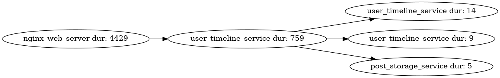

* Description of dot graphs for code generation

Example:

#+BEGIN_SRC dot  :file test-dot.png
strict digraph "" {
	graph [rankdir=LR];
	node [label="\N"];
	nginx_web_server	[dur=4429,
		id=nginx_web_server,
		label="nginx_web_server dur: 4429",
		serv=nginx_web_server];
	user_timeline_service	[dur=759,
		id=user_timeline_service,
		label="user_timeline_service dur: 759",
		serv=user_timeline_service];
	nginx_web_server -> user_timeline_service;
	user_timeline_service_	[dur=14,
		id=user_timeline_service_,
		label="user_timeline_service dur: 14",
		serv=user_timeline_service];
	user_timeline_service -> user_timeline_service_;
	user_timeline_service__	[dur=9,
		id=user_timeline_service__,
		label="user_timeline_service dur: 9",
		serv=user_timeline_service];
	user_timeline_service -> user_timeline_service__;
	post_storage_service	[dur=5,
		id=post_storage_service,
		label="post_storage_service dur: 5",
		serv=post_storage_service];
	user_timeline_service -> post_storage_service;
}
#+END_SRC

#+RESULTS:

- One node = One span of execution
- Edges: precedence constraints
  - One node with one child => sequential execution with depedency (parent
    executed before children starts, in this one for example, nginx_web_server
    precedes the execution of user_timeline_service)
  - One node with multiple childs => the user will choose when executing the
    code generation script whether to execute childs in parallel or sequentially
- Important parameters:
  - label=just the name shown in the graph
  - serv = service that will execute the span *IMPORTANT*
  - dur = duration spent in the span *IMPORTANT*
  - id = similar to label but without the duration written

